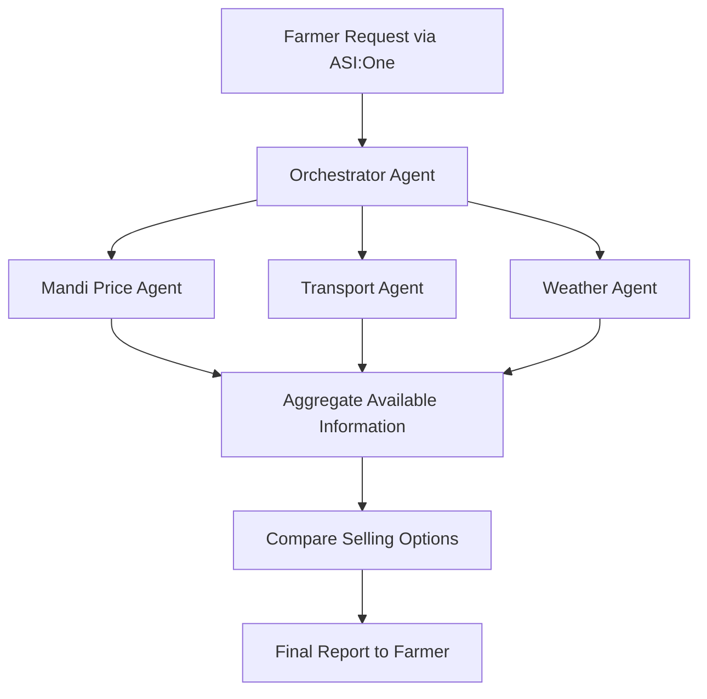

# 🌾 Kisan Sahayak — From Mandi to Money


**An Agentic AI Assistant for Smarter Agricultural Selling Decisions**

Kisan Sahayak is a multi-agent AI-powered agricultural decision-support system built for **Fetch-A-Thon 3.0 — ASI Agent Challenge: From Intent to Action**.

It helps farmers compare crop-selling options by bringing together available mandi-price information, estimated transportation expenses, and weather-related context. Instead of considering the selling price alone, Kisan Sahayak aims to help farmers understand which available selling option may provide better estimated net earnings.

---

## 🔗 Project Links

- **GitHub Repository:** [https://github.com/meenakshi2730/kisan-sahayak](https://github.com/meenakshi2730/kisan-sahayak)
- **ASI Shared Chat:** https://asi1.ai/chat/6adfa193-f909-42fe-833a-fc5b36117c7d
- **Demo Video:** https://drive.google.com/file/d/1Gef96sPbjRRwg512rG9DWMaU_plcqEqA/view?usp=drivesdk

## 🤖 Deployed Agents

| Agent | Agent Address | Agentverse Profile |
|---|---|---|
| Kisan_orchestration | `agent1qvqag4d4zfnmq7vdv37uke5sxtngj7fck5ehqkzjw32at7rr4nrnsjl2tc4` | [View Profile](https://agentverse.ai/agents/details/agent1qvqag4d4zfnmq7vdv37uke5sxtngj7fck5ehqkzjw32at7rr4nrnsjl2tc4/profile) |
| Price_Agent | `agent1qdywqnr5x3erg66wn5a6fqnr8t07l3wkgeeh0damr00h2828efgds9y2fsv` | [View Profile](https://agentverse.ai/agents/details/agent1qdywqnr5x3erg66wn5a6fqnr8t07l3wkgeeh0damr00h2828efgds9y2fsv/profile) |
| Transport_agent | `agent1qvcum94m6ceg3usw920gnwcl5kjaz6aucj6ycqcafkue8guh9590wnlf0rp` | [View Profile](https://agentverse.ai/agents/details/agent1qvcum94m6ceg3usw920gnwcl5kjaz6aucj6ycqcafkue8guh9590wnlf0rp/profile) |
| Weather_Agent | `agent1qvkh25lu0v0guewt03ttzee78jr0420jf6tevtdv7d92cy04z4pru5lr9qv` | [View Profile](https://agentverse.ai/agents/details/agent1qvkh25lu0v0guewt03ttzee78jr0420jf6tevtdv7d92cy04z4pru5lr9qv/profile) |

---

## 📌 Problem Statement

Farmers often face a difficult question: **Where and when should they sell their crops to get better returns?**

The mandi offering the highest price may not necessarily provide the highest net earnings. Farmers must also consider transportation expenses, weather conditions, produce quality, and potential spoilage.

Key challenges include:

- **Varying mandi prices:** Different markets may offer different prices for the same crop.
- **Transportation expenses:** A distant market offering a higher price may leave the farmer with less money after transport costs.
- **Weather uncertainty:** Rain and humidity can affect transportation and produce handling.
- **Fragmented information:** Market prices, transport costs, and weather information may need to be checked separately.
- **Complex decisions:** Comparing several selling options manually can be difficult and time-consuming.

**Our challenge:** How can agentic AI coordinate information from multiple sources to help farmers make more informed crop-selling decisions?

## 💡 Our Solution

Kisan Sahayak is a farmer-oriented AI assistant that coordinates specialized agents to generate a structured crop-selling report.

A farmer can provide details such as the crop, quantity, location, and selling urgency. The system processes the request, gathers available information, compares relevant selling options, and returns a consolidated response.

### Key Features

- **Multi-agent coordination:** An orchestrator manages the workflow across specialized agents.
- **Mandi price comparison:** Evaluates available crop-price information across markets.
- **Transport-cost consideration:** Accounts for estimated transportation expenses.
- **Weather-aware guidance:** Uses available weather information to support selling and handling decisions.
- **Estimated net earnings:** Helps compare potential returns after applicable costs.
- **Practical recommendations:** Provides selling guidance and produce-handling suggestions based on available information.
- **Hosted agent interaction:** Supports the project's deployed workflow through the Fetch.ai ecosystem.

### Target Users

- Farmers comparing crop-selling options.
- Small and marginal farmers seeking accessible market information.
- Agricultural support organizations helping farmers evaluate selling decisions.

---

## 🏗️ Multi-Agent Architecture



### 1. Orchestrator Agent

- Receives and interprets the farmer's request.
- Coordinates the relevant specialized agents.
- Collects and consolidates available results.
- Produces the final selling-decision report.

### 2. Price Agent

- Retrieves or processes available mandi-price information.
- Compares prices across relevant markets.
- Provides market information for evaluating selling options.

### 3. Transport Agent

- Considers estimated transportation expenses.
- Helps evaluate the impact of transport costs on potential earnings.
- Supports comparisons between selling destinations.

### 4. Weather Agent

- Retrieves weather information for the relevant location.
- Provides weather context for selling and transportation planning.
- Supports produce-handling guidance based on available conditions.

Together, these agents aim to transform a farmer's request into a more complete selling-decision report.

---

## 🔄 How It Works

1. **Farmer submits a request:** The farmer provides the crop, quantity, location, and relevant preferences.
2. **Orchestrator processes the request:** It determines the information needed for the selling decision.
3. **Price Agent evaluates market information:** Available mandi prices are retrieved or processed.
4. **Transport Agent considers costs:** Estimated transportation expenses are used in the comparison where available.
5. **Weather Agent provides context:** Weather information supports the selling and handling guidance.
6. **Orchestrator consolidates results:** Available information is brought together.
7. **Farmer receives a report:** The agent presents the comparison, estimated earnings, and recommendations supported by the available data.

The primary workflow is designed for interaction through ASI, using the deployed agent setup.

---

## 🧪 Example: Tomato Selling Report

The following example is based on an actual response from the deployed Kisan Sahayak agent.

### Farmer Request

- **Crop:** Tomato
- **Quantity:** 20 quintals
- **Location:** Bengaluru
- **Selling urgency:** Not specified

### Mandi Comparison

| Mandi | Price per quintal | Estimated transport | Reported take-home |
|---|---:|---:|---:|
| Binny Mill (FF&V) Bengaluru APMC | ₹1,600 | ₹641 | ₹29,455 |
| Yeshwanthpur APMC | ₹1,400 | ₹500 | ₹25,834 |
| KR Market Bengaluru | ₹1,250 | ₹500 | ₹23,012 |

In this example, the agent recommends **Binny Mill (FF&V) Bengaluru APMC** based on its reported estimated take-home amount.

### Weather and Produce Handling

The report also provides weather information, an estimated spoilage risk, and practical recommendations such as:

- Keep tomatoes dry and inspect for decay.
- Use covered transportation during rain.
- Store tomatoes in shade and ventilated crates.
- Separate damaged or soft tomatoes before loading.

**Data note:** These figures reproduce the agent's response and have not been independently verified. Market prices, transport estimates, distances, commission, spoilage assumptions, and net-earnings calculations should be validated before being treated as accurate financial estimates. The agent should distinguish live data from sample or fallback data.

---

## 🧮 Net Earnings Concept

Kisan Sahayak uses the principle that the highest selling price does not always mean the best financial outcome.

**Estimated Net Earnings = Expected Sale Revenue − Transportation Cost − Other Included Selling Costs**

Where:

- **Expected sale revenue** = expected selling price per unit × quantity sold.
- **Transportation cost** = estimated expense for transporting produce to the selected mandi.
- **Other included selling costs** may include commission and spoilage-related losses where supported by the implementation.

Actual earnings depend on market prices, accepted quantities, transport charges, produce quality, and other applicable expenses. Estimates are not guaranteed profits.

---

## 🛠️ Technology Stack

| Technology | Purpose |
|---|---|
| Python | Core agent logic and application implementation |
| Fetch.ai uAgents | Building autonomous agents |
| Agentverse | Agent hosting, registration, and discovery |
| Agent Chat Protocol (ACP) | Agent interaction and communication, where configured |
| ASI | Agent discovery and user interaction |
| AGMARKNET | Agricultural market-price data source |
| Open-Meteo API | Weather information |
| Git and GitHub | Version control and source-code collaboration |

External data availability depends on the relevant source, API configuration, and deployed implementation.

---

## 📂 Repository Structure

```text
kisan-sahayak/
├── agents/                    # Agent implementations
├── data/                      # Supporting and sample data
├── docs/                      # Documentation and message schemas
├── hosted/                    # Hosted-agent implementations
├── tests/                      # Automated tests
├── orchestrator.py            # Orchestrator implementation
├── chat_client.py             # Chat client / interaction utility
├── ping_agent.py              # Agent connectivity test utility
├── agent1qgnwdcl7fh_data.json  # Agent-related configuration/data
├── requirements.txt           # Python dependencies
├── .gitignore                 # Files excluded from version control
└── README.md                  # Project documentation
```

The repository may contain additional supporting files. Refer to the source tree for the latest implementation.

---

## ⚙️ Setup and Testing

### Prerequisites

- Python 3.11 or a compatible version supported by the project dependencies.
- Git.
- Required environment configuration and API access for external services.
- Agentverse and ASI access for hosted-agent interaction.

### 1. Clone the Repository

```bash
git clone https://github.com/meenakshi2730/kisan-sahayak.git
cd kisan-sahayak
```

### 2. Create a Virtual Environment

```bash
python -m venv .venv
```

Activate on Windows PowerShell:

```powershell
.\.venv\Scripts\Activate.ps1
```

### 3. Install Dependencies

```bash
python -m pip install --upgrade pip
pip install -r requirements.txt
```

### 4. Configure Environment Variables

Configure the agent seeds and external API settings required by the project.

- Store secrets in a local `.env` file or secure hosting settings.
- Never commit API keys, private agent seeds, passwords, or credentials.
- Do not publish private environment files.

### 5. Run Tests

```bash
python -m unittest discover -s tests -p "test_*.py" -v
```

Use the relevant agent entry points and configuration instructions to run the system locally. Startup requirements may depend on the integration and hosting setup.

---

## ☁️ Deployment

Kisan Sahayak's agents have been hosted on Agentverse for the project demonstration.

The deployed-agent table above should contain the exact public agent names, addresses, and profile URLs. Do not publish private seeds or API credentials.

For evaluation, use the ASI shared chat URL and Agentverse profiles provided in the project submission.

---
### 🚀 Live Demo
---
Experience Kisan Sahayak — From Mandi to Money through our deployed ASI workflow.

1.📊 Mandi Comparison
---
The system compares available mandi prices, estimated transportation costs, and estimated take-home amounts to help farmers make informed selling decisions.
<br>
 
<br>

2.✅ Final Selling Decision
---
For the demonstration request of 20 quintals of tomatoes near Bengaluru, the system recommends Binny Mill (FF&V) Bengaluru APMC based on the highest reported estimated take-home amount.
<br>
 
<br>

---

## 🌱 Real-World Impact

Kisan Sahayak aims to help farmers make more informed crop-selling decisions by bringing market information, transportation considerations, and weather context together in one workflow.

By considering estimated earnings after relevant costs, the system helps illustrate why a mandi with a higher price may not always be the most suitable option.

The project is a decision-support prototype. Real-world effectiveness depends on reliable data, accurate cost calculations, and validation against actual agricultural and market conditions.

---

## 🔮 Future Scope

- Expand support for additional crops and mandis.
- Improve transport estimates using verified distances and current rates.
- Improve live-data reliability and error handling.
- Add multilingual interaction for farmers.
- Improve spoilage estimation using crop-specific and environmental factors.
- Validate recommendations against actual selling outcomes.
- Explore further agent-to-agent coordination and additional agricultural services.

---

## 🏆 Hackathon

**Fetch-A-Thon 3.0 — ASI Agent Challenge: From Intent to Action**

Built using the Fetch.ai ecosystem to demonstrate how specialized AI agents can collaborate on a practical agricultural problem.

**Kisan Sahayak — From Mandi to Money 🌾**
